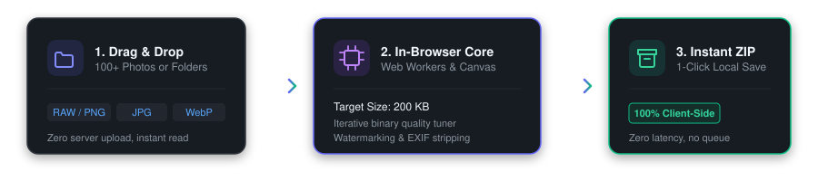

# OmniKit — Zero-Knowledge Client-Side Web Utilities & Tools

[](https://www.npmjs.com/package/omnikit-tools)
[](https://omnikit.tech)
[](https://opensource.org/licenses/MIT)
[](https://omnikit.tech)
[](https://omnikit.tech)
[](https://omnikit.tech)

A comprehensive open-source collection of **40+ high-performance client-side browser utilities, converters, and hardware diagnostics**.  
**100% in-browser processing. Zero server compute. Zero data leakage.**

<p align="center">
  
</p>

- Production Web App: [https://omnikit.tech](https://omnikit.tech)
- English Version: [https://omnikit.tech/en/](https://omnikit.tech/en/)
- Official Repository: [https://github.com/Morendais/omnikit](https://github.com/Morendais/omnikit)
- Author: [Morendais](https://github.com/Morendais)
- License: MIT

[English](#english) | [Русский](#russian)

---

<a name="english"></a>
## English

### Open Source Proof of Privacy

This GitHub repository provides verifiable, open-source proof of privacy for users of [omnikit.tech](https://omnikit.tech).

All tool logic hosted on omnikit.tech is published here in plain, unminified JavaScript. Anyone can independently inspect, audit, and verify that:
1. **Zero Data Uploads:** Files, audio buffers, webcam frames, and text inputs are never uploaded to any remote server or third-party cloud.
2. **100% Client-Side Execution:** All computation runs entirely inside the user's browser using native Web APIs (Web Audio, Web Crypto, HTML5 Canvas, Web Workers, MediaDevices).
3. **Zero Keystroke Logging:** Inputs in sensitive tools (Password Generator, JWT Decoder, Diff Checker) are never recorded.
4. **Verifiable via DevTools:** Open the Network tab in your browser developer tools (F12) while performing any conversion or diagnostic test. Exactly 0 bytes of user data are transmitted.

---

> **Note on Analytics & Privacy:** The `omnikit-tools` open-source library contains **zero tracking, zero analytics, and zero external telemetry**. The showcase website ([omnikit.tech](https://omnikit.tech)) uses optional privacy-compliant analytics (Yandex Metrika / Google Analytics) **strictly after explicit user cookie consent**; all tools and data processing execute 100% locally on your machine without transmitting any user files or inputs.

---

### Directory of All 40+ Live Tools

Every tool can be launched directly in your browser or used via individual canonical URLs:

#### Hardware Diagnostics

| Tool | Live Web Link | Description |
| :--- | :--- | :--- |
| **Online Microphone Test** | [Launch Online](https://omnikit.tech/en/mic-test) | Audio frequency visualizer, decibel meter and voice test |
| **Online Webcam Test** | [Launch Online](https://omnikit.tech/en/webcam-test) | Resolution check, live FPS counter, mirror and snapshot |
| **Online Keyboard Test** | [Launch Online](https://omnikit.tech/en/keyboard-test) | 104-key state matrix, stuck key detection and ghosting test |
| **Online Mouse Test** | [Launch Online](https://omnikit.tech/en/mouse-test) | Double-click chatter detection, scroll wheel speed, CPS test |

#### Image & Media Processing

| Tool | Live Web Link | Description |
| :--- | :--- | :--- |
| **HEIC to JPG / PNG** | [Launch Online](https://omnikit.tech/en/heic-to-jpg) | Convert Apple iPhone HEIC/HEIF photos to JPG or PNG |
| **Image Compressor** | [Launch Online](https://omnikit.tech/en/image-compressor) | Lossless & lossy compression for PNG, JPG, WebP |
| **Image Converter** | [Launch Online](https://omnikit.tech/en/image-converter) | Convert between PNG, JPG, WebP with zero quality loss |
| **Image Resizer** | [Launch Online](https://omnikit.tech/en/image-resizer) | Scale dimensions, preset aspect ratios (1:1, 16:9, 4:3), rotate |
| **Background Remover** | [Launch Online](https://omnikit.tech/en/background-remover) | In-browser neural segmentation (U2-Net INT8 ONNX) with 100% client-side privacy |
| **Watermark Studio** | [Launch Online](https://omnikit.tech/en/watermark) | Draggable watermarks, custom typography, HSL color spectrum |
| **Favicon Generator** | [Launch Online](https://omnikit.tech/en/favicon-generator) | Multi-resolution Windows ICO (16x16, 32x32, 48x48) & PNG favicons |
| **SVG to PNG Converter** | [Launch Online](https://omnikit.tech/en/svg-to-png) | Vector SVG rasterizer up to 4x Retina with XSS sanitization |
| **SVG to ICO Converter** | [Launch Online](https://omnikit.tech/en/svg-to-ico) | Multi-size Windows .ico builder and Apple Touch icons |
| **EXIF Metadata Remover** | [Launch Online](https://omnikit.tech/en/exif-remover) | Strip GPS coordinates, camera model, and privacy metadata |
| **OCR Text Recognition** | [Launch Online](https://omnikit.tech/en/image-to-text) | Extract text from scans and images in your browser |
| **Audio Speed & Pitch** | [Launch Online](https://omnikit.tech/en/audio-speed-changer) | Adjust tempo, shift pitch, Slowed + Reverb, Nightcore |
| **PNG to JPG Converter** | [Launch Online](https://omnikit.tech/en/png-to-jpg) | Instant format change with background fill |
| **WebP to JPG Converter** | [Launch Online](https://omnikit.tech/en/webp-to-jpg) | Universal WebP to standard JPEG converter |
| **WebP to PNG Converter** | [Launch Online](https://omnikit.tech/en/webp-to-png) | Convert WebP to lossless transparent PNG |

#### PDF Suite

| Tool | Live Web Link | Description |
| :--- | :--- | :--- |
| **Images to PDF** | [Launch Online](https://omnikit.tech/en/images-to-pdf) | Compile photos and scans into a single formatted PDF |
| **Merge PDF** | [Launch Online](https://omnikit.tech/en/merge-pdf) | Combine multiple PDF documents into one with page reordering |
| **Split PDF** | [Launch Online](https://omnikit.tech/en/split-pdf) | Extract specific page ranges or split into individual pages |
| **PDF to JPG** | [Launch Online](https://omnikit.tech/en/pdf-to-jpg) | Render and extract high-resolution PDF pages as JPG images |

#### Developer Utilities

| Tool | Live Web Link | Description |
| :--- | :--- | :--- |
| **JSON Formatter & Validator** | [Launch Online](https://omnikit.tech/en/json-formatter) | Beautify, minify, validate strict syntax and copy clean JSON |
| **JWT Decoder & Epoch Time** | [Launch Online](https://omnikit.tech/en/jwt-decoder) | Decode base64url claims and translate Unix timestamps without secrets |
| **Password Generator** | [Launch Online](https://omnikit.tech/en/password-generator) | Cryptographically secure passwords with WebCrypto entropy check |
| **Cryptographic Hashes** | [Launch Online](https://omnikit.tech/en/hash-generator) | Instant client-side calculation of SHA-256, SHA-512, MD5 |
| **Base64 Converter** | [Launch Online](https://omnikit.tech/en/base64-converter) | UTF-8 compliant text and data Base64 encode/decode |
| **RegEx Tester & Evaluator** | [Launch Online](https://omnikit.tech/en/regex-tester) | Interactive regular expression tester with live match highlighting |
| **CSV to JSON Converter** | [Launch Online](https://omnikit.tech/en/csv-to-json) | RFC 4180 compliant tabular CSV to structured JSON parser |
| **UTM Builder & URL Encode** | [Launch Online](https://omnikit.tech/en/utm-generator) | Generate marketing campaign tracking URLs and encode query strings |
| **AI Token Counter** | [Launch Online](https://omnikit.tech/en/token-counter) | BPE token estimation & pricing for GPT-4o, Claude 3.5, Gemini, DeepSeek |
| **Color Studio & EyeDropper** | [Launch Online](https://omnikit.tech/en/color-converter) | Screen EyeDropper and instant HEX, RGB, HSL color conversion |
| **QR Code Generator & Scanner** | [Launch Online](https://omnikit.tech/en/qr-generator) | Custom QR codes for Wi-Fi, links, crypto, plus image scanner |

#### Text & Office Tools

| Tool | Live Web Link | Description |
| :--- | :--- | :--- |
| **Text & Word Counter** | [Launch Online](https://omnikit.tech/en/text-counter) | Character, word, line counts and social media limit indicators |
| **Text Diff Checker** | [Launch Online](https://omnikit.tech/en/diff-checker) | Side-by-side text comparison with highlighted additions and deletions |
| **Text Case Converter** | [Launch Online](https://omnikit.tech/en/case-converter) | UPPERCASE, lowercase, Title Case, camelCase, snake_case |
| **Text Cleaner & Notepad** | [Launch Online](https://omnikit.tech/en/txt-editor) | Deduplicate lines, sort alphabetically, trim excess whitespace |
| **Transliteration & URL Slug** | [Launch Online](https://omnikit.tech/en/translit) | Convert Cyrillic to Latin and generate clean SEO URL slugs |
| **Number to Words Converter** | [Launch Online](https://omnikit.tech/en/num-to-words) | Spell currency amounts and cardinal numbers in Russian and English |

### Architecture & Privacy Model

- **Zero Network Uploads:** File conversions and data parsing occur purely in client RAM.
- **Offline-First:** All computation logic is self-contained and works with offline service worker support.
- **Zero Tracking:** Pure algorithm implementations without analytics or keystroke logging.
- **Standards Compliant:** WebAssembly, Web Audio API, Canvas 2D, WebCrypto, PDF.js.

### Quick Start & Local Development

```bash
# 1. Clone the repository
git clone https://github.com/Morendais/omnikit.git
cd omnikit

# 2. Run automated test suite
node test.js

# 3. Start local development server
node dev-server.js
# Open http://localhost:8080 in your browser
```

### Standalone Library Usage (Node.js & CommonJS)

The standalone modules can also be imported directly in JavaScript / Node.js projects:

```javascript
const { DevTools, TextTools, OfficeTools } = require('./index.js');

// Example: Calculate MD5 (RFC 1321)
const hash = DevTools.fastMd5('hello');
console.log('MD5:', hash);

// Example: Generate secure password (16 chars)
const password = DevTools.generatePassword(16);
console.log('Password:', password);

// Example: Character count
const stats = TextTools.updateStats('Sample text');
console.log('Stats:', stats);

// Example: Number to words
console.log(OfficeTools.spellEnglishNumber(125));
// Output: "one hundred twenty-five"
```

---

<a name="russian"></a>
## Русский

### Открытое доказательство приватности

Этот репозиторий на GitHub создан для независимого подтверждения безопасности и приватности сервиса [omnikit.tech](https://omnikit.tech).

Весь код инструментов, работающих на сайте, открыт для публичного аудита:
1. **Ноль загрузок на сервер:** Ваши файлы, снимки с веб-камеры, аудиопоток с микрофона и вводимый текст никогда не покидают ваше устройство.
2. **100% клиентская обработка:** Все вычисления производятся в оперативной памяти браузера с помощью стандартных Web API (Web Audio, Web Crypto, HTML5 Canvas, Web Workers, MediaDevices).
3. **Защита ввода:** Данные в чувствительных инструментах (генератор паролей, JWT-декодер, Diff-чекер) никогда не сохраняются и не логируются.
4. **Проверяемо через DevTools:** Откройте вкладку Network (F12) в браузере при работе с любым инструментом на сайте — исходящий трафик с вашими данными равен 0 байт.

---

> **Примечание о приватности и аналитике:** Код открытой библиотеки `omnikit-tools` **не содержит трекеров, телеметрии и сторонних запросов**. Витринный веб-сервис ([omnikit.tech](https://omnikit.tech)) использует веб-аналитику (Яндекс Метрика / Google Analytics) **строго после явного согласия пользователя в cookie-баннере**; сами алгоритмы и файлы никогда не покидают ваше устройство.

---

### Каталог всех 40+ онлайн-инструментов

Каждый инструмент доступен по прямой постоянной ссылке в браузере:

#### Диагностика оборудования

| Инструмент | Прямая ссылка | Описание |
| :--- | :--- | :--- |
| **Тест микрофона онлайн** | [Открыть инструмент](https://omnikit.tech/mic-test) | Анализатор частот, измерение громкости и проверка звука |
| **Тест веб-камеры онлайн** | [Открыть инструмент](https://omnikit.tech/webcam-test) | Проверка разрешения, счетчик FPS, зеркало и моментальный снимок |
| **Тест клавиатуры онлайн** | [Открыть инструмент](https://omnikit.tech/keyboard-test) | Проверка всех клавиш, залипаний и мульти-нажатий (NKRO) |
| **Тест мыши онлайн** | [Открыть инструмент](https://omnikit.tech/mouse-test) | Детектор аппаратного дабл-клика, тест скролла и скорости кликов |

#### Работа с изображениями

| Инструмент | Прямая ссылка | Описание |
| :--- | :--- | :--- |
| **HEIC в JPG / PNG** | [Открыть инструмент](https://omnikit.tech/heic-to-jpg) | Конвертация фото с iPhone (HEIC) в стандартный JPG или PNG |
| **Сжатие изображений** | [Открыть инструмент](https://omnikit.tech/image-compressor) | Сжатие PNG, JPG, WebP с точной настройкой качества |
| **Конвертер изображений** | [Открыть инструмент](https://omnikit.tech/image-converter) | Быстрая смена формата PNG, JPG, WebP без потери качества |
| **Изменение размера фото** | [Открыть инструмент](https://omnikit.tech/image-resizer) | Масштабирование, пропорции 1:1, 16:9, 4:3 и поворот фото |
| **Удаление фона с фото** | [Открыть инструмент](https://omnikit.tech/background-remover) | Локальное удаление фона с фото и экспорт в прозрачный PNG |
| **Водяной знак на фото** | [Открыть инструмент](https://omnikit.tech/watermark) | Наложение водяных знаков, выбор цвета по HSL, шрифты и логотипы |
| **Генератор Favicon** | [Открыть инструмент](https://omnikit.tech/favicon-generator) | Создание пакета иконок для сайта (favicon.ico и PNG) |
| **SVG в PNG** | [Открыть инструмент](https://omnikit.tech/svg-to-png) | Рендеринг векторного SVG в PNG высокого разрешения |
| **SVG в ICO** | [Открыть инструмент](https://omnikit.tech/svg-to-ico) | Конвертация SVG в мульти-резолюционный Windows .ico |
| **Очистка EXIF данных** | [Открыть инструмент](https://omnikit.tech/exif-remover) | Удаление геолокации, модели камеры и скрытых метаданных |
| **Распознавание текста (OCR)** | [Открыть инструмент](https://omnikit.tech/image-to-text) | Браузерное оптическое распознавание текста с картинок |
| **Скорость и тональность аудио** | [Открыть инструмент](https://omnikit.tech/audio-speed-changer) | Управление темпом, тональностью, Slowed + Reverb и Nightcore |
| **PNG в JPG** | [Открыть инструмент](https://omnikit.tech/png-to-jpg) | Конвертация PNG в JPG с заливкой прозрачности |
| **WebP в JPG** | [Открыть инструмент](https://omnikit.tech/webp-to-jpg) | Конвертация современных фото WebP в JPG |
| **WebP в PNG** | [Открыть инструмент](https://omnikit.tech/webp-to-png) | Конвертация WebP в PNG с сохранением прозрачности |

#### Работа с PDF

| Инструмент | Прямая ссылка | Описание |
| :--- | :--- | :--- |
| **Картинки в PDF** | [Открыть инструмент](https://omnikit.tech/images-to-pdf) | Сборка фотографий и сканов в единый PDF документ |
| **Объединить PDF** | [Открыть инструмент](https://omnikit.tech/merge-pdf) | Склейка нескольких PDF файлов в один с сортировкой |
| **Разделить PDF** | [Открыть инструмент](https://omnikit.tech/split-pdf) | Извлечение нужных страниц или разбивка на части |
| **PDF в JPG** | [Открыть инструмент](https://omnikit.tech/pdf-to-jpg) | Рендеринг и сохранение страниц PDF в виде картинок JPG |

#### Инструменты разработчика

| Инструмент | Прямая ссылка | Описание |
| :--- | :--- | :--- |
| **JSON Форматтер** | [Открыть инструмент](https://omnikit.tech/json-formatter) | Форматирование с отступами, сжатие и валидация JSON |
| **JWT Декодер и Timestamp** | [Открыть инструмент](https://omnikit.tech/jwt-decoder) | Расшифровка токенов JWT и перевод Unix времени |
| **Генератор паролей** | [Открыть инструмент](https://omnikit.tech/password-generator) | Криптостойкие пароли с расчетом энтропии через WebCrypto |
| **Хеширование данных** | [Открыть инструмент](https://omnikit.tech/hash-generator) | Расчет контрольных сумм SHA-256, SHA-512, MD5 |
| **Base64 Кодировщик** | [Открыть инструмент](https://omnikit.tech/base64-converter) | Кодирование и декодирование Base64 с поддержкой UTF-8 |
| **RegEx Tester (Регулярки)** | [Открыть инструмент](https://omnikit.tech/regex-tester) | Интерактивное тестирование регулярных выражений онлайн |
| **CSV в JSON** | [Открыть инструмент](https://omnikit.tech/csv-to-json) | Конвертер таблиц CSV в JSON по стандарту RFC 4180 |
| **UTM Генератор** | [Открыть инструмент](https://omnikit.tech/utm-generator) | Конструктор ссылок с UTM-метками и URL-кодирование |
| **Счетчик токенов AI** | [Открыть инструмент](https://omnikit.tech/token-counter) | Подсчет токенов и расчет стоимости для популярных нейросетей |
| **Конвертер цветов и Пипетка** | [Открыть инструмент](https://omnikit.tech/color-converter) | Пипетка с экрана и перевод кодов HEX, RGB, HSL |
| **Генератор и Сканер QR** | [Открыть инструмент](https://omnikit.tech/qr-generator) | Генерация цветных QR-кодов и сканирование с картинок |

#### Текст и Офис

| Инструмент | Прямая ссылка | Описание |
| :--- | :--- | :--- |
| **Счетчик символов и слов** | [Открыть инструмент](https://omnikit.tech/text-counter) | Подсчет символов, слов, строк и лимиты для соцсетей |
| **Сравнение текстов (Diff)** | [Открыть инструмент](https://omnikit.tech/diff-checker) | Наглядное сравнение двух текстов с подсветкой различий |
| **Конвертер регистра** | [Открыть инструмент](https://omnikit.tech/case-converter) | Смена регистра: ЗАГЛАВНЫЕ, строчные, CamelCase, snake_case |
| **Блокнот и очистка текста** | [Открыть инструмент](https://omnikit.tech/txt-editor) | Удаление дубликатов строк, сортировка и очистка пробелов |
| **Транслитерация и Слаги** | [Открыть инструмент](https://omnikit.tech/translit) | Перевод кириллицы в латиницу и генератор SEO слагов |
| **Сумма прописью** | [Открыть инструмент](https://omnikit.tech/num-to-words) | Сумма прописью для договоров и счетов (рубли, доллары, евро) |

### Автор и создатель

Проект OmniKit разработан и поддерживается **[Morendais](https://github.com/Morendais)**.
- **Профиль GitHub**: [@Morendais](https://github.com/Morendais)
- **Официальный сайт**: [https://omnikit.tech](https://omnikit.tech)
- **Репозиторий**: [https://github.com/Morendais/omnikit](https://github.com/Morendais/omnikit)

### Лицензия

Лицензия MIT. Разрешено свободное коммерческое и некоммерческое использование.
